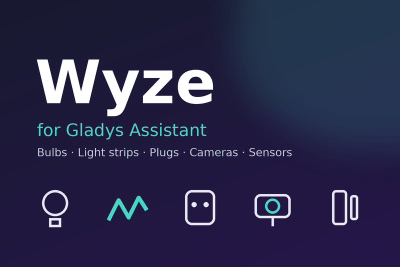

# Gladys Assistant — Wyze integration

External integration for [Gladys Assistant](https://gladysassistant.com)
(5.3 or later) that brings your [Wyze](https://www.wyze.com) devices into
Gladys: bulbs, light strips, plugs, cameras and Wyze Sense sensors.



## Features

| Wyze device                         | Gladys features                                      | Channel      |
| ----------------------------------- | ---------------------------------------------------- | ------------ |
| White bulbs                         | on/off, brightness, color temperature                | cloud        |
| Color bulbs, light strips           | on/off, brightness, color temperature, color         | local, cloud |
| Plugs, outdoor plugs                | on/off                                               | cloud        |
| Cameras                             | latest image, motion, power, siren, motion detection | cloud        |
| Floodlight Pro, Battery Cam Pro, OG | latest image, motion                                 | cloud        |
| Wyze Sense contact / motion sensors | open/closed or motion, low battery                   | cloud        |

On top of the devices:

- **Scene triggers** — _Wyze camera event_ (motion, sound, smoke/CO alarm,
  doorbell, face; person, vehicle, pet, package with Cam Plus) and _Wyze
  device online/offline_;
- **Scene actions** — camera siren, camera motion detection, camera image,
  refresh the devices;
- **Dashboard widgets** — _Wyze overview_ and _Wyze camera_;
- **Transport badge** — local / cloud / unreachable per device, degraded when
  a local command fell back to the cloud;
- **Four languages** — English, French, German, Spanish.

The user documentation is in [`docs/`](docs/en.md)
([français](docs/fr.md), [Deutsch](docs/de.md), [español](docs/es.md)); Gladys
links it from the Configuration screen.

## Install

In Gladys, open **Integrations**, search for **Wyze** and install it. You need
a Wyze API key: create it in the
[Wyze developer console](https://developer-api-console.wyze.com/#/apikey/view),
then follow the [documentation](docs/en.md).

To test a build before it is in the catalog: **Integrations → Install an
integration → Developer mode**, and paste the manifest of the
[Build workflow summary](../../actions/workflows/build.yml).

## Development

```bash
npm install
npm test                 # unit tests (node --test), no network
npm run lint             # ESLint
npm run format:check     # Prettier
```

Run it against a Gladys instance:

```bash
GLADYS_HOST_API_URL="http://localhost:1443" \
GLADYS_INTEGRATION_TOKEN="<token>" \
GLADYS_INTEGRATION_SELECTOR="wyze" \
WYZE_DATA_DIR="./data" \
LOG_LEVEL=debug \
npm start
```

The architecture and the project rules are described in
[`CLAUDE.md`](CLAUDE.md).

## Release

1. Describe the changes under `## [Unreleased]` in [`CHANGELOG.md`](CHANGELOG.md).
2. **Actions → Release → Run workflow**, pick `patch`, `minor` or `major`.

The workflow bumps the version everywhere, tags it, builds the
`linux/amd64` + `linux/arm64` image to `ghcr.io/gboulvin/gladys-wyze` and
publishes the GitHub Release. The image package must be **public** on GHCR
for Gladys to pull it.

## Credits and disclaimer

The Wyze cloud API is not officially documented: this integration relies on
the work of the [wyzeapy](https://github.com/SecKatie/wyzeapy) and
[wyze-sdk](https://github.com/shauntarves/wyze-sdk) projects. It is not
affiliated with, endorsed by or supported by Wyze Labs; Wyze may change its
API without notice.

## License

Apache-2.0
